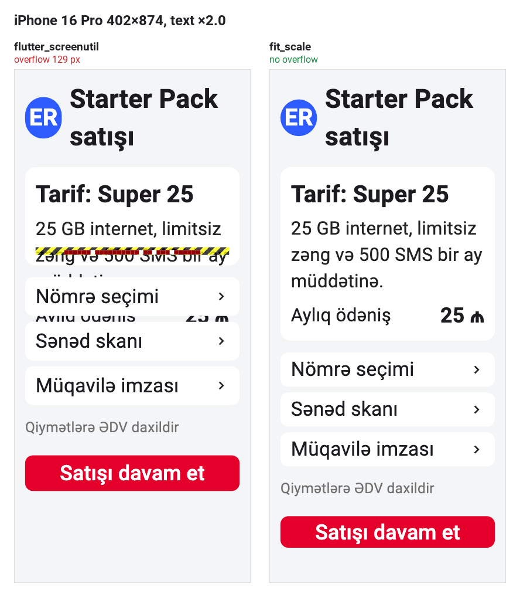
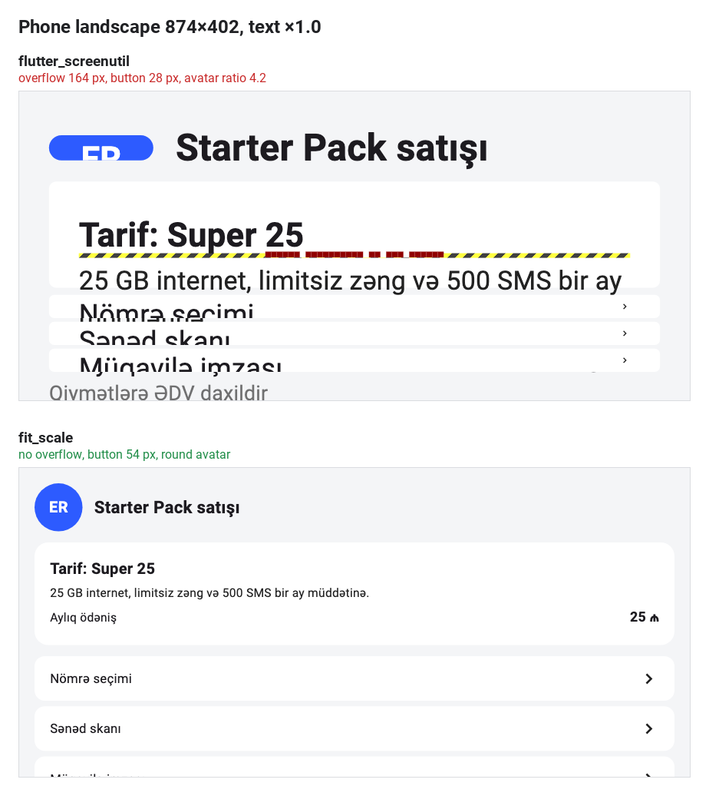
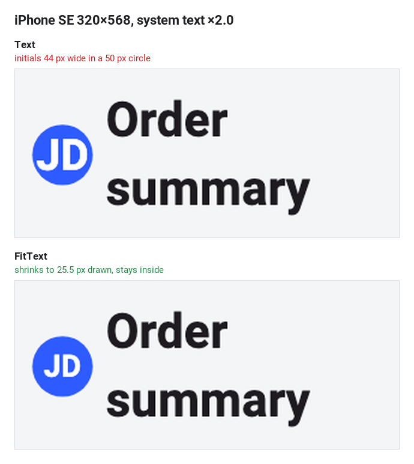
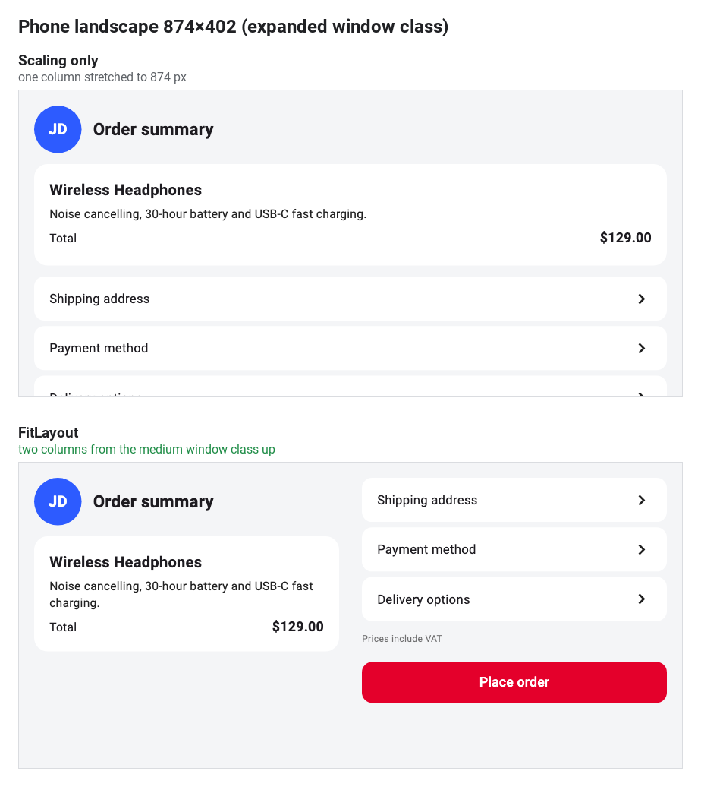
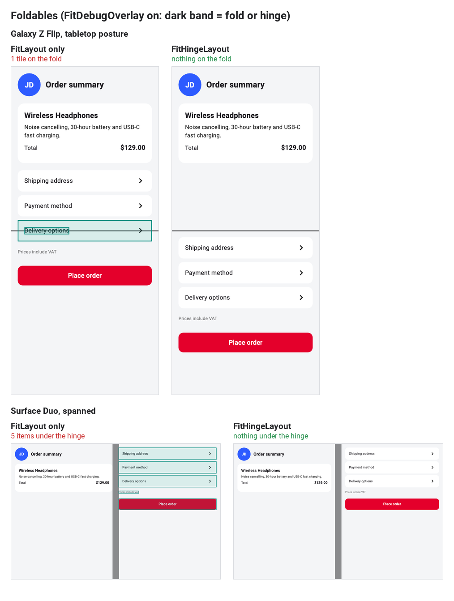
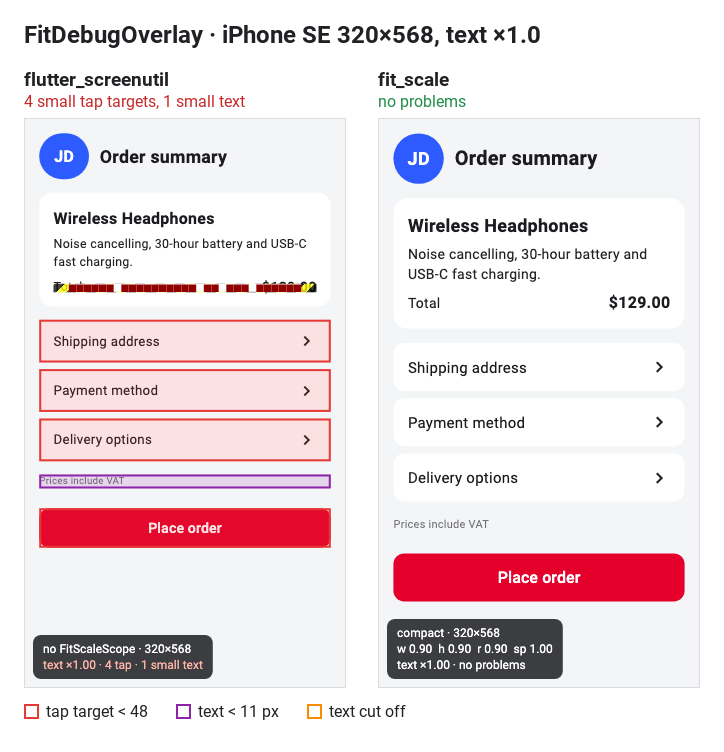
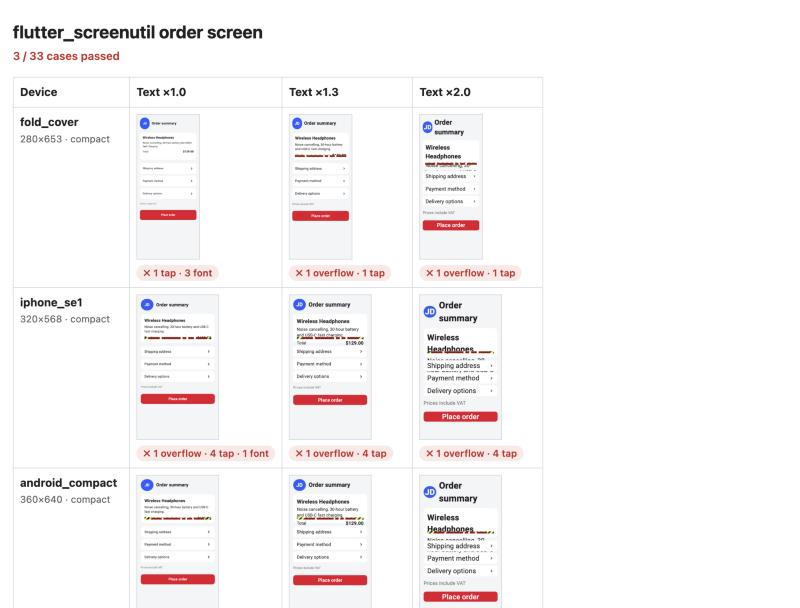

# fit_scale

[](https://github.com/arahimli/fit_scale/actions/workflows/ci.yml)

Responsive sizing for Flutter that does not break on small, large or rotated
screens — and a test harness that proves it for every screen you ship.

## Why

Linear scaling (`value × screenWidth / designWidth`, as in
`flutter_screenutil`) has no floor and no ceiling. Measured on one ordinary
screen designed at 360×690:

| Device | What linear scaling did |
|---|---|
| iPhone SE 320×568, default text | overflowed by 4.9 px, button 39.5 px tall, 11 sp caption drawn at 9.8 px |
| Galaxy Fold cover 280×653 | caption 8.6 px, 56×56 avatar became 44×53 |
| Any phone, system text ×2.0 | fixed `.h` heights overflowed by 167–204 px |
| iPad mini | overflowed by 34 px at default text, avatar 116×92 |
| Phone landscape 874×402 | button 28 px, overflow 164 px, avatar ratio 4.2 |

With fit_scale the same screen passes on all of them: 0 of 24 device and
text-size combinations fail, against 24 of 24 with linear scaling.


<details>
<summary>More: iPhone 16 Pro with text ×2.0, phone in landscape</summary>





</details>

## What it does

- **Clamped factors.** Width, height and uniform scale stay within
  `0.9–1.25` by default, so a tiny phone does not shrink your layout to 78 %
  and a tablet does not blow it up to 200 %.
- **Touch-target floor.** `tap()` never returns less than 48 (Android) or
  44 (iOS).
- **Fonts never below the design.** `sp()` only grows (up to 1.15×). The
  user's system text size is applied on top by Flutter as usual.
- **Boxes that grow.** `FitBox` is a minimum height, not a fixed one, so
  large text pushes the box taller instead of overflowing.
- **Shapes that keep their shape.** `r()` and `FitSquare` use one factor
  based on the shortest side, so circles stay circles and nothing jumps
  when the device rotates.
- **Text that fits where nothing can grow.** `FitText` shrinks only when
  it does not fit (an avatar, a badge, a one-line header), and never below
  a minimum size drawn on screen, system text size included.
- **Context first.** Sizes come from `context.fit` through an
  `InheritedWidget`: only the widgets that read it rebuild when the size
  changes, and a nested `FitScaleScope(useLayoutSize: true)` scales a
  split-view pane by its own size. `56.w`-style extensions are available
  in a separate import for migrating from flutter_screenutil.
- **Layouts per window class.** `fit.when`, `fit.pick` and `FitLayout`
  switch layouts at Material 3's window size classes, by screen or by
  pane, and rebuild only when the class changes.
- **Foldables.** `fit.hinge` and `FitHingeLayout` put content on either
  side of a half-open fold or a hinge; the harness and the overlay flag
  anything lying across one.
- **Live debug overlay.** `FitDebugOverlay` outlines small tap targets,
  small text and cut-off text on top of the running app, with the same
  thresholds as the test harness.
- **Test harness.** `testFitScale` renders a screen on 11 device sizes × 3
  system text sizes and fails on overflow, small tap targets and tiny text,
  with an HTML report of every case and a table in your CI job summary.
- **Not tied to Material.** The library imports only
  `package:flutter/widgets.dart`, so it is unaffected by the Material split
  (see below) and works the same with Material, Cupertino or your own
  design system.

## Flutter 3.47+ and the Material split

Flutter 3.47 deprecated `package:flutter/material.dart` in favour of the
separate `material_ui` package. fit_scale does not import either: it needs
no `material_ui` dependency and no import changes in your app, and the same
version works from Flutter 3.24 to the latest stable. CI runs on both ends
of that range.

## Usage

```dart
void main() => runApp(
      const FitScaleScope(
        config: FitScaleConfig(designSize: Size(360, 690)),
        child: MaterialApp(home: CheckoutPage()),
      ),
    );

class CheckoutPage extends StatelessWidget {
  const CheckoutPage({super.key});

  @override
  Widget build(BuildContext context) {
    final fit = context.fit;
    return ListView(
      padding: EdgeInsets.all(fit.w(16)),
      children: [
        FitSquare(
          size: 56,
          child: const CircleAvatar(
            child: Padding(padding: EdgeInsets.all(8), child: FitText('ER')),
          ),
        ),
        SizedBox(height: fit.h(16)),
        FitBox(
          height: 96,
          child: Text('Plan details', style: TextStyle(fontSize: fit.sp(14))),
        ),
        FitBox(
          height: 48,
          interactive: true,
          child: FilledButton(onPressed: () {}, child: const Text('Continue')),
        ),
      ],
    );
  }
}
```

| Call | Use for |
|---|---|
| `fit.w(v)` | horizontal sizes: padding, widths |
| `fit.h(v)` | vertical gaps |
| `fit.r(v)` | anything that must keep its shape: icons, radii, avatars |
| `fit.sp(v)` | font sizes |
| `fit.tap(v)` | heights of interactive elements |
| `fit.clamped(v, min:, max:)` | a uniform size with your own limits |
| `FitBox(height:, interactive:)` | instead of `SizedBox(height: x.h)` around text |
| `FitSquare(size:)` | instead of `width: x.w, height: x.h` for squares |
| `FitText(text, minFontSize:)` | text in a space that cannot grow |
| `fit.when(compact:, medium:, ...)` | a different layout per window class |
| `fit.pick(compact:, medium:, ...)` | a different value per window class |
| `FitLayout(compact:, medium:, ...)` | the same as a widget, rebuilding only on class change |
| `FitHingeLayout(single:, start:, end:)` | panes on either side of a fold or hinge |
| `FitDebugOverlay(child:)` | live outlines of problems while you develop |

### FitText

`FitBox` lets a box grow with its text. When the box cannot grow, use
`FitText`: it keeps the style's font size if the text fits, otherwise
finds the largest size that does, down to `minFontSize` (default 11). The
floor is the size drawn on screen after the user's system text scale, the
same number the harness's `minFont` check uses, so the two never
disagree. If the text does not fit even at the floor, `overflow` applies
(ellipsis by default).

```dart
FitSquare(
  size: 56,
  child: DecoratedBox(
    decoration: const BoxDecoration(
      shape: BoxShape.circle,
      color: Color(0xFF2D5BFF),
    ),
    child: Padding(
      padding: EdgeInsets.all(context.fit.r(8)), // stay inside the circle
      child: Center(
        child: FitText('JD', style: TextStyle(fontSize: context.fit.sp(18))),
      ),
    ),
  ),
)
```

Measured on 8 devices × 3 text sizes: with a plain `Text` the initials
leave the circle in all 8 cases at text ×2.0; with `FitText` in none of
the 24.



`maxLines` defaults to 1. Set it to `null` to let the text wrap onto as
many lines as the height allows (an ellipsis then becomes a clip, because
Flutter would otherwise cut the first line).

### Breakpoints

Scaling fixes sizes, not layouts: in landscape or on a tablet a phone
layout is still one long column. Window classes follow Material 3, by
width:

| Class | Width | Typical device |
|---|---|---|
| `compact` | < 600 | phones in portrait |
| `medium` | 600–839 | unfolded foldables, iPad mini |
| `expanded` | 840–1199 | tablets, phones in landscape |
| `large` | 1200–1599 | large tablets in landscape |
| `extraLarge` | ≥ 1600 | desktop windows |

```dart
FitLayout(
  compact: (_) => const OrderColumn(),
  medium: (_) => const Row(children: [
    Expanded(child: OrderSummary()),
    Expanded(child: OrderActions()),
  ]),
)
```

Mobile first: a class without a builder falls back to the nearest
narrower one, so this shows two columns on every class from `medium` up.
`fit.when(...)` does the same inline, `fit.pick(compact: 1, medium: 2,
expanded: 3)` returns values instead of widgets.

- `FitLayout` and `FitScale.windowClassOf(context)` rebuild only when the
  window or height class changes, not on every pixel of a resize.
- Below `FitScaleScope(useLayoutSize: true)` the class follows the pane,
  like a container query: a 430 px detail pane on a tablet is `compact`.
- A phone in landscape is `expanded` by width but `FitHeightClass.compact`
  by height (`fit.heightClass`), for choices such as full-screen dialogs.
- Change the boundaries with
  `FitScaleConfig(breakpoints: FitBreakpoints(medium: 500, ...))`.



### Foldables

A half-open foldable or a dual-screen device has a line through the
screen: text and buttons on it are hard to read and tap. Flutter reports
it through `MediaQuery.displayFeatures` (Android only; there are no
foldable iPhones). fit_scale turns that into one value:

```dart
final hinge = context.fit.hinge; // null on an ordinary screen
hinge?.posture; // book, tabletop or flat (a physical hinge)
hinge?.bounds;  // where it is
```

Only separating features count, by Flutter's own rule: a fold that is
half open, or a hinge with a width. A fully opened fold leaves the screen
one surface, so `hinge` is null and nothing changes.

```dart
FitHingeLayout(
  single: (_) => const OrderColumn(),
  start: (_) => const OrderSummary(), // left, or top in tabletop posture
  end: (_) => const OrderActions(),   // right, or the half on the table
)
```

`start` and `end` are placed exactly either side of the fold, with
nothing on a hinge (right to left: `start` on the right). It does not
need to fill the screen: below an app bar it still splits at the fold.

The harness has `FitDevices.foldables` (Galaxy Z Fold in book posture,
Galaxy Z Flip in tabletop posture, Surface Duo spanned) and a
`FitCheck.hingeOverlap` check, in the defaults, that fails when a line
of text or a tap target lies across the fold. It only fires on devices
with one, so adding it changed nothing for other devices. Foldables are
not in `FitDevices.all`; add them where your app supports them:

```dart
testFitScale(
  'checkout',
  () => const MyApp(home: CheckoutPage()),
  devices: [...FitDevices.all, ...FitDevices.foldables],
);
```

Measured on the order screen: with `FitLayout` alone 4 of 9 foldable cases
pass (5 items under the Surface Duo hinge, a tile on the Flip's fold, and
the Fold passes only because the gap between columns happens to sit on
the fold); with `FitHingeLayout` 9 of 9.



These devices are simulated in tests by setting the view's display
features. On the Pixel Fold Android emulator (API 36) the device reports
the same shape of data (a zero-width fold through the middle, flat when
fully open and half-opened at a 90° hinge angle), and `fit.hinge`,
`FitHingeLayout` and the overlay behaved as in the tests in book and
tabletop posture. Not yet checked on physical foldables or a Surface Duo.

### Configuration

```dart
FitScaleConfig(
  designSize: Size(375, 812),
  minScale: 0.9,      // floor for w / h / r
  maxScale: 1.25,     // ceiling for w / h / r
  minFontScale: 1.0,  // fonts never smaller than the design
  maxFontScale: 1.15,
  minTapTarget: null, // null: 44 on iOS, 48 elsewhere
)
```

## Debug overlay

The harness finds problems in tests; `FitDebugOverlay` shows the same
problems on the running app while you work:

```dart
FitScaleScope(
  config: const FitScaleConfig(designSize: Size(360, 690)),
  child: FitDebugOverlay(child: MaterialApp(home: CheckoutPage())),
)
```

| Outline | Problem | Same check as |
|---|---|---|
| red | tap target below 48×48 (Android) or 44×44 (iOS) | `FitCheck.tapTargets` |
| purple | text drawn below `minFontSize` (11 px) | `FitCheck.minFont` |
| orange | text cut off by `maxLines` | `FitCheck.truncatedText` |
| teal | text or a tap target across a fold or hinge (drawn as a dark band) | `FitCheck.hingeOverlap` |

Overflow is not repeated: Flutter already draws its striped bar. Both use
one implementation of the text checks, so what is outlined on screen is
what a test would report.

A panel in the corner shows the window class, screen size, scale factors
and system text scale; tap it to collapse it. Put the overlay inside
`FitScaleScope` so the panel can read the factors.



- `enabled` defaults to `kDebugMode`; in release builds the overlay is
  just its child. While on, it keeps the semantics tree alive to find tap
  targets and scans after each frame.
- It does not ask for frames of its own and repaints only when the list
  of problems changes. Touches go straight through to the app.
- `onProblems` gets the full list whenever it changes, for logging.
- `minFontSize`, `minTapTarget`, `showPanel`, `panelAlignment` and
  `panelTextStyle` (the panel sits above your theme) can be changed.

## Testing your screens

```dart
import 'package:fit_scale/testing.dart';

void main() {
  setUpAll(loadFitScaleTestFonts); // real glyphs instead of Ahem

  testFitScale('checkout', () => const MyApp(home: CheckoutPage()));
}
```

This defines 33 tests (11 devices × text ×1.0, ×1.3, ×2.0): phones from a
280 px foldable cover up, an unfolded foldable and two iPads for the medium
and expanded classes, and a phone in landscape. A failure lists
every problem found:

```
android_compact 360x640, text x1.3: 3 problem(s)
  - [overflow] A RenderFlex overflowed by 45 pixels on the bottom.
  - [tapTargets] SemanticsNode#6(Rect.fromLTRB(165.0, 40.0, 195.0, 70.0), actions: [tap]): expected tap target size of at least Size(48.0, 48.0), but found Size(30.0, 30.0)
  - [minFont] "Prices include VAT" renders at 10.4 px, below 11.0
```

Options: `devices` (`FitDevices.small`, `.phones`, `.tablets`, `.foldables`, `.all` or your own
`FitDevice`), `textScales`, `minFontSize`, `checks`, and `goldenDir` to save a
screenshot per case. For custom setup, call `pumpFitScreen` inside your own
`testWidgets` and inspect the returned `FitReport`.

`checks` defaults to `FitCheck.defaults` (overflow, tap targets, small
text, and content across a fold on foldable devices). `FitCheck.truncatedText` also reports text cut off by `maxLines`,
including a `FitText` that did not fit at its minimum. It is opt-in
because many apps cut long names on purpose:

```dart
testFitScale(
  'profile',
  () => const MyApp(home: ProfilePage()),
  checks: {...FitCheck.defaults, FitCheck.truncatedText},
);
```

### Report

Pass `reportDir` to get one page per screen instead of 33 separate test
results:

```dart
testFitScale(
  'checkout',
  () => const MyApp(home: CheckoutPage()),
  reportDir: 'build/fit_scale_report',
);
```

When the group finishes (also when cases fail) it writes:

| File | Contents |
|---|---|
| `checkout.html` | devices × text sizes, a screenshot per case, every problem listed below |
| `checkout.md` | the same table in markdown, for a pull request comment |
| `checkout.json` | the raw results |
| `index.html` | every screen in the directory with its pass count |

On GitHub Actions the markdown table is also added to the job summary, so
the result is on the run page without opening the logs. Keep the HTML as
an artifact:

```yaml
- run: flutter test
- uses: actions/upload-artifact@v4
  if: always()
  with:
    name: fit_scale-report
    path: build/fit_scale_report
```

Call `loadFitScaleTestFonts` in `setUpAll` so screenshots show real text.
For your own reports, build a `FitScreenReport` from `pumpFitScreen`
results and use `toMarkdown()`, `toHtml()` or `writeFitReport`.



The job summary for the same screen starts like this:

```
### flutter_screenutil order screen: 3 / 33 passed

| Device | Class | Text ×1.0 | Text ×1.3 | Text ×2.0 |
|---|---|---|---|---|
| fold_cover 280×653 | compact | ✗ 1 tap · 3 font | ✗ 1 overflow · 1 tap | ✗ 1 overflow · 1 tap |
| iphone_se1 320×568 | compact | ✗ 1 overflow · 4 tap · 1 font | ✗ 1 overflow · 4 tap | ✗ 1 overflow · 4 tap |
| iphone16pro 402×874 | compact | ✓ | ✗ 1 overflow | ✗ 1 overflow |
```

The same screen written with fit_scale passes all 33.

## Migrating from flutter_screenutil

### 1. Swap the import

`package:fit_scale/extensions.dart` has the same `num` extensions as
flutter_screenutil (`.w .h .r .sp .sw .sh .verticalSpace
.horizontalSpace`), backed by fit_scale's clamped factors. Your screens
compile unchanged:

```dart
// import 'package:flutter_screenutil/flutter_screenutil.dart';
import 'package:fit_scale/extensions.dart';

// ScreenUtilInit(designSize: const Size(360, 690), builder: ...)
FitScaleScope(
  config: const FitScaleConfig(designSize: Size(360, 690)),
  child: MaterialApp(...),
)
```

Extensions read the root scope, so a size change rebuilds the whole tree
below it, the same as flutter_screenutil. `context.fit` rebuilds only the
widgets that read it; prefer it in new code.

### 2. Find what still breaks

The swap alone is not a fix. Measured on the demo screen across 24 device
and text-size cases:

| | Cases failing | Overflow | Button < 48 | Text < 11 px | Distorted |
|---|---|---|---|---|---|
| flutter_screenutil | 24 | 21 | 15 | 2 | 24 |
| Import swapped only | 21 | 19 | 15 | 0 | 12 |
| After step 3 | **0** | 0 | 0 | 0 | 0 |

Text no longer shrinks below the design, which is the point, but a fixed
`SizedBox(height: x.h)` built around shrinking text can now overflow
*more*: on an iPhone SE with text ×1.3 the overflow grows from 28 px to
60 px. Buttons sized with `.h` stay below the touch-target minimum.

Run the harness on each screen to get the list:

```dart
testFitScale('checkout', () => const MyApp(home: CheckoutPage()));
```

### 3. Fix what the harness reports

| flutter_screenutil habit | fit_scale |
|---|---|
| `SizedBox(height: 52.h)` around text | `FitBox(height: 52)` |
| `height: 48.h` on a button or tile | `48.tap`, or `FitBox(height: 48, interactive: true)` |
| `width: 56.w, height: 56.h` | `FitSquare(size: 56)` or `56.r` for both |

| flutter_screenutil | fit_scale extension | fit_scale context API |
|---|---|---|
| `16.w` | `16.w` | `context.fit.w(16)` |
| `16.h` | `16.h` | `context.fit.h(16)` |
| `16.r` | `16.r` | `context.fit.r(16)` |
| `16.sp` | `16.sp` | `context.fit.sp(16)` |
| `0.5.sw` / `0.5.sh` | `0.5.sw` / `0.5.sh` | `context.fit.size.width * 0.5` |
| `16.verticalSpace` | `16.verticalSpace` | `SizedBox(height: context.fit.h(16))` |
| — | `48.tap` | `context.fit.tap(48)` |
