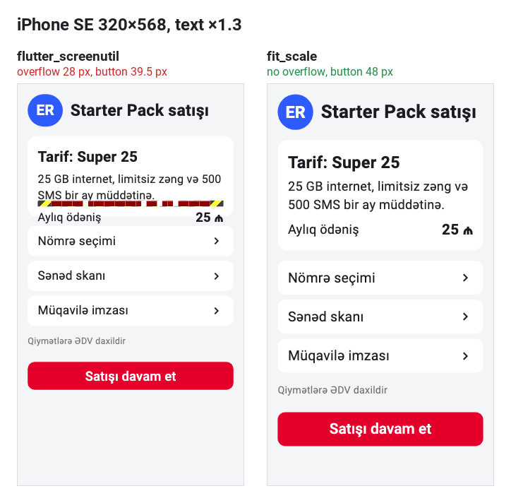

# fit_scale

[](https://github.com/arahimli/fit_scale/actions/workflows/ci.yml)

Responsive sizing for Flutter that does not break on small, large or rotated
screens — and a test harness that proves it for every screen you ship.

## Why

Linear scaling (`value × screenWidth / designWidth`, as in
`flutter_screenutil`) has no floor and no ceiling. Measured on one ordinary
screen designed at 360×690:

| Device | What linear scaling did |
|---|---|
| iPhone SE 320×568, default text | overflowed by 4.9 px, button 39.5 px tall, 11 sp caption drawn at 9.8 px |
| Galaxy Fold cover 280×653 | caption 8.6 px, 56×56 avatar became 44×53 |
| Any phone, system text ×2.0 | fixed `.h` heights overflowed by 167–204 px |
| iPad mini | overflowed by 34 px at default text, avatar 116×92 |
| Phone landscape 874×402 | button 28 px, overflow 164 px, avatar ratio 4.2 |

With fit_scale the same screen passes on all of them: 0 of 24 device and
text-size combinations fail, against 24 of 24 with linear scaling.



<details>
<summary>More: iPhone 16 Pro with text ×2.0, phone in landscape</summary>


</details>

## What it does

- **Clamped factors.** Width, height and uniform scale stay within
  `0.9–1.25` by default, so a tiny phone does not shrink your layout to 78 %
  and a tablet does not blow it up to 200 %.
- **Touch-target floor.** `tap()` never returns less than 48 (Android) or
  44 (iOS).
- **Fonts never below the design.** `sp()` only grows (up to 1.15×). The
  user's system text size is applied on top by Flutter as usual.
- **Boxes that grow.** `FitBox` is a minimum height, not a fixed one, so
  large text pushes the box taller instead of overflowing.
- **Shapes that keep their shape.** `r()` and `FitSquare` use one factor
  based on the shortest side, so circles stay circles and nothing jumps
  when the device rotates.
- **Context first.** Sizes come from `context.fit` through an
  `InheritedWidget`: only the widgets that read it rebuild when the size
  changes, and a nested `FitScaleScope(useLayoutSize: true)` scales a
  split-view pane by its own size. `56.w`-style extensions are available
  in a separate import for migrating from flutter_screenutil.
- **Test harness.** `testFitScale` renders a screen on 9 device sizes × 3
  system text sizes and fails on overflow, small tap targets and tiny text.
- **Not tied to Material.** The library imports only
  `package:flutter/widgets.dart`, so it is unaffected by the Material split
  (see below) and works the same with Material, Cupertino or your own
  design system.

## Flutter 3.47+ and the Material split

Flutter 3.47 deprecated `package:flutter/material.dart` in favour of the
separate `material_ui` package. fit_scale does not import either: it needs
no `material_ui` dependency and no import changes in your app, and the same
version works from Flutter 3.24 to the latest stable. CI runs on both ends
of that range.

## Usage

```dart
void main() => runApp(
      const FitScaleScope(
        config: FitScaleConfig(designSize: Size(360, 690)),
        child: MaterialApp(home: CheckoutPage()),
      ),
    );

class CheckoutPage extends StatelessWidget {
  const CheckoutPage({super.key});

  @override
  Widget build(BuildContext context) {
    final fit = context.fit;
    return ListView(
      padding: EdgeInsets.all(fit.w(16)),
      children: [
        FitSquare(size: 56, child: const CircleAvatar(child: Text('ER'))),
        SizedBox(height: fit.h(16)),
        FitBox(
          height: 96,
          child: Text('Plan details', style: TextStyle(fontSize: fit.sp(14))),
        ),
        FitBox(
          height: 48,
          interactive: true,
          child: FilledButton(onPressed: () {}, child: const Text('Continue')),
        ),
      ],
    );
  }
}
```

| Call | Use for |
|---|---|
| `fit.w(v)` | horizontal sizes: padding, widths |
| `fit.h(v)` | vertical gaps |
| `fit.r(v)` | anything that must keep its shape: icons, radii, avatars |
| `fit.sp(v)` | font sizes |
| `fit.tap(v)` | heights of interactive elements |
| `fit.clamped(v, min:, max:)` | a uniform size with your own limits |
| `FitBox(height:, interactive:)` | instead of `SizedBox(height: x.h)` around text |
| `FitSquare(size:)` | instead of `width: x.w, height: x.h` for squares |

### Configuration

```dart
FitScaleConfig(
  designSize: Size(375, 812),
  minScale: 0.9,      // floor for w / h / r
  maxScale: 1.25,     // ceiling for w / h / r
  minFontScale: 1.0,  // fonts never smaller than the design
  maxFontScale: 1.15,
  minTapTarget: null, // null: 44 on iOS, 48 elsewhere
)
```

## Testing your screens

```dart
import 'package:fit_scale/testing.dart';

void main() {
  setUpAll(loadFitScaleTestFonts); // real glyphs instead of Ahem

  testFitScale('checkout', () => const MyApp(home: CheckoutPage()));
}
```

This defines 27 tests (9 devices × text ×1.0, ×1.3, ×2.0). A failure lists
every problem found:

```
android_compact 360x640, text x1.3: 3 problem(s)
  - [overflow] A RenderFlex overflowed by 45 pixels on the bottom.
  - [tapTargets] SemanticsNode#6(Rect.fromLTRB(165.0, 40.0, 195.0, 70.0), actions: [tap]): expected tap target size of at least Size(48.0, 48.0), but found Size(30.0, 30.0)
  - [minFont] "Prices include VAT" renders at 10.4 px, below 11.0
```

Options: `devices` (`FitDevices.small`, `.phones`, `.all` or your own
`FitDevice`), `textScales`, `minFontSize`, `checks`, and `goldenDir` to save a
screenshot per case. For custom setup, call `pumpFitScreen` inside your own
`testWidgets` and inspect the returned `FitReport`.

## Migrating from flutter_screenutil

### 1. Swap the import

`package:fit_scale/extensions.dart` has the same `num` extensions as
flutter_screenutil (`.w .h .r .sp .sw .sh .verticalSpace
.horizontalSpace`), backed by fit_scale's clamped factors. Your screens
compile unchanged:

```dart
// import 'package:flutter_screenutil/flutter_screenutil.dart';
import 'package:fit_scale/extensions.dart';

// ScreenUtilInit(designSize: const Size(360, 690), builder: ...)
FitScaleScope(
  config: const FitScaleConfig(designSize: Size(360, 690)),
  child: MaterialApp(...),
)
```

Extensions read the root scope, so a size change rebuilds the whole tree
below it, the same as flutter_screenutil. `context.fit` rebuilds only the
widgets that read it; prefer it in new code.

### 2. Find what still breaks

The swap alone is not a fix. Measured on the demo screen across 24 device
and text-size cases:

| | Cases failing | Overflow | Button < 48 | Text < 11 px | Distorted |
|---|---|---|---|---|---|
| flutter_screenutil | 24 | 21 | 15 | 2 | 24 |
| Import swapped only | 21 | 19 | 15 | 0 | 12 |
| After step 3 | **0** | 0 | 0 | 0 | 0 |

Text no longer shrinks below the design, which is the point, but a fixed
`SizedBox(height: x.h)` built around shrinking text can now overflow
*more*: on an iPhone SE with text ×1.3 the overflow grows from 28 px to
60 px. Buttons sized with `.h` stay below the touch-target minimum.

Run the harness on each screen to get the list:

```dart
testFitScale('checkout', () => const MyApp(home: CheckoutPage()));
```

### 3. Fix what the harness reports

| flutter_screenutil habit | fit_scale |
|---|---|
| `SizedBox(height: 52.h)` around text | `FitBox(height: 52)` |
| `height: 48.h` on a button or tile | `48.tap`, or `FitBox(height: 48, interactive: true)` |
| `width: 56.w, height: 56.h` | `FitSquare(size: 56)` or `56.r` for both |

| flutter_screenutil | fit_scale extension | fit_scale context API |
|---|---|---|
| `16.w` | `16.w` | `context.fit.w(16)` |
| `16.h` | `16.h` | `context.fit.h(16)` |
| `16.r` | `16.r` | `context.fit.r(16)` |
| `16.sp` | `16.sp` | `context.fit.sp(16)` |
| `0.5.sw` / `0.5.sh` | `0.5.sw` / `0.5.sh` | `context.fit.size.width * 0.5` |
| `16.verticalSpace` | `16.verticalSpace` | `SizedBox(height: context.fit.h(16))` |
| — | `48.tap` | `context.fit.tap(48)` |
